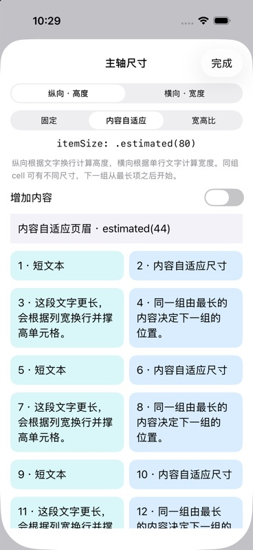
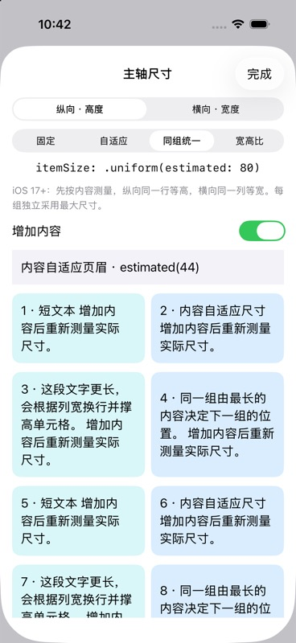
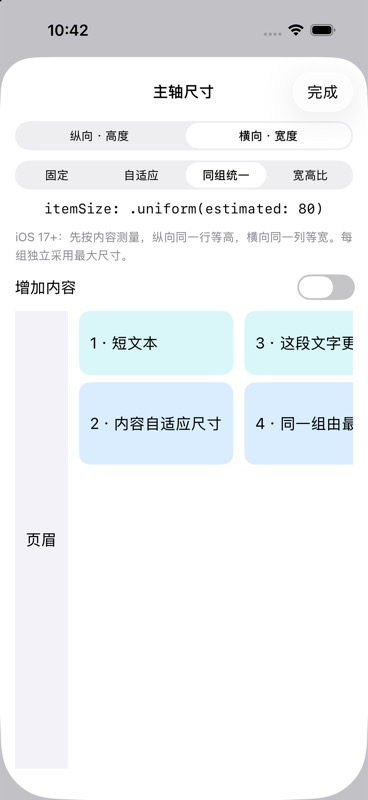

# GridItemSizeLayoutDemo

使用同一组参数，对比 SwiftUI `LazyVGrid` / `LazyHGrid` 和 UIKit compositional layout。

布局库位于独立仓库 [UIKitGridLayouts](https://github.com/astralchen/UIKitGridLayouts)，通过 `Packages/UIKitGridLayouts` submodule 和本地 Swift Package 路径引用。示例的 submodule 固定到 [UIKitGridLayouts 0.3.0](https://github.com/astralchen/UIKitGridLayouts/releases/tag/0.3.0) 标签对应提交，包含固定、内容自适应、同组统一和宽高比四种主轴尺寸策略；0.2.x 的调用方需要按下文迁移。

## 运行截图

以下为示例 App 在 **iPhone 17 Pro / iOS 26.5 模拟器**上的真实运行截图。四种模式均使用“自适应”容器尺寸、居中对齐、12 pt 主轴间距，并关闭“上限 112”。单元格第二行显示实测列宽或行高。

| 模式 | 纵向 VGrid：上方 SwiftUI，下方 UIKit | 横向 HGrid：左侧 SwiftUI，右侧 UIKit |
| --- | :---: | :---: |
| **fixed**<br>固定 3 条轨道，每条 72 pt |  |  |
| **flexible**<br>固定 3 条轨道，minimum 为 64 pt |  |  |
| **adaptive**<br>minimum 为 80 pt，自动展开轨道 |  |  |
| **混合**<br>混合：fixed 70 + flexible 80…140 + adaptive minimum 60 |  |  |

截图保留两套布局的真实尺寸读数，包括少量小数差异；展示的是当前配置的运行效果，不替代所有边界情况和最低系统版本的验证。

## 运行

1. 首次获取示例后，先在仓库根目录运行 `git submodule update --init --recursive` 下载布局库。克隆示例时也可使用 `git clone --recurse-submodules https://github.com/astralchen/GridItemSizeLayoutDemo.git`。
2. 用 Xcode 打开 `GridItemSizeLayoutDemo/GridItemSizeLayoutDemo.xcodeproj`。
3. 选择 `GridItemSizeLayoutDemo` scheme 和 iPhone / iPad 模拟器，运行。
4. 对比 App 最低 iOS 16；独立库最低 iOS 15，使用 Swift tools 6.3 和 Swift 6 language mode。模拟器无需配置开发团队，真机运行需要自行选择签名团队。

## 主轴尺寸示例

导航栏“主轴尺寸”打开独立页面，可切换纵向/横向与固定/内容自适应/同组统一/宽高比。打开“增加内容”观察 estimated 重新测量；fixed 与 aspectRatio 保持各自的尺寸规则。页眉和页脚也使用 estimated。Debug 参数 `--grid-sizing` 可直接打开该页面；添加 `--grid-sizing-mode uniform` 可在 iOS 17+ 直接选择同组统一，`--grid-axis horizontal` 选择横向。

## 多分区布局

导航栏“多分区”入口展示同一集合视图中的五种独立布局：fixed、flexible、adaptive、混排和 UIKit 原生横向轮播。每个分区有独立的尺寸、间距与对齐。

示例通过 `UIKitLazyVGridLayout.makeSection(..., environment:)` 生成分区，并在外层 `sectionProvider` 按索引选择；横向宿主对应 `UIKitLazyHGridLayout.makeSection`。此 API 从 UIKitGridLayouts 0.2.0 起提供。Debug 参数 `--grid-sections` 可直接打开该页面。


| 独立页眉页脚与分区背景 | 吸附配置与原生横向轮播 |
| :---: | :---: |
|  |  |

以上为 iPhone 17 Pro / iOS 26.5 的多分区页面运行截图。

### 每个分区独立配置辅助视图与背景

“多分区”页同时演示以下配置；页眉和页脚文本直接标明吸附状态，背景使用不同颜色区分分区。分区包含足够多的单元格，可上下滚动观察辅助视图在所属分区范围内的吸附和离开。

| 分区 | Header 高度 | Footer 高度 | 吸附选项 | 背景 |
| --- | ---: | ---: | --- | --- |
| fixed | 36 pt | 28 pt | 不吸附 | 蓝色 |
| flexible | 44 pt | 32 pt | `.sectionHeaders` | 青色 |
| adaptive | 36 pt | 36 pt | `.sectionFooters` | 橙色 |
| 混排 | 44 pt | 32 pt | `[.sectionHeaders, .sectionFooters]` | 紫色 |
| UIKit 原生轮播 | 36 pt | 28 pt | 不吸附 | 粉色 |

网格分区通过 `makeSection` 的参数分别指定 header、footer 和吸附。背景则使用 UIKit 的 decoration：

```swift
let layout = UICollectionViewCompositionalLayout { sectionIndex, environment in
    // 示例参数按分区独立存放；可替换为你的数据模型。
    let style = SectionDemoStyle.all[sectionIndex]
    let section = UIKitLazyVGridLayout.makeSection(
        columns: [UIKitGridItem(.adaptive(minimum: 85), spacing: 8)],
        spacing: 12,
        pinnedViews: style.pinnedViews,
        itemSize: .fixed(56),
        headerSize: .fixed(style.headerHeight),
        footerSize: .fixed(style.footerHeight),
        contentInsets: .init(top: 8, leading: 16, bottom: 12, trailing: 16),
        environment: environment
    )
    let background = NSCollectionLayoutDecorationItem.background(
        elementKind: SectionBackgroundView.elementKind
    )
    background.contentInsets = .init(top: 0, leading: 8, bottom: 0, trailing: 8)
    background.zIndex = -1
    section.decorationItems = [background]
    return section
}
layout.register(
    SectionBackgroundView.self,
    forDecorationViewOfKind: SectionBackgroundView.elementKind
)
```

`SectionDemoStyle`、`SectionBackgroundView` 和下面的 `SectionBoundaryView` 都是示例 App 中定义的类型，不属于 UIKitGridLayouts 的公开 API。背景视图在 `apply(_:)` 中读取 `layoutAttributes.indexPath.section`，使用该分区的颜色；复用时每次重新设置颜色。

Header/footer 属于 supplementary view，由集合视图注册并由数据源提供。只设置尺寸或 `pinnedViews` 不会自动创建视图：

```swift
for kind in [UICollectionView.elementKindSectionHeader,
             UICollectionView.elementKindSectionFooter] {
    collectionView.register(
        SectionBoundaryView.self,
        forSupplementaryViewOfKind: kind,
        withReuseIdentifier: "boundary"
    )
}

// 在数据源的 viewForSupplementaryElementOfKind 回调中：
let view = collectionView.dequeueReusableSupplementaryView(
    ofKind: kind, withReuseIdentifier: "boundary", for: indexPath
) as! SectionBoundaryView
view.configure(
    section: indexPath.section,
    isHeader: kind == UICollectionView.elementKindSectionHeader
)
return view
```

- Header/footer 分别通过 `kind` 配置内容；示例每次复用都会覆盖文本、颜色和无障碍标识。
- Decoration 由 layout 管理，不进入数据源的 supplementary 回调，也不增加数据源的 item 数量。
- `pinToVisibleBounds` 相对集合视图的可见边界生效，并受所属分区范围约束；页脚吸底不是固定在整个屏幕底部的工具栏。
- 原生轮播 section 直接创建自己的 boundary supplementary items；它与网格 section 共用注册和数据源机制。
- 将某个 headerSize/footerSize 设为 nil 可省略对应布局项；不要对未注册的 kind 创建布局项。


## 对比页

Debug 构建可在 Xcode 的 Run → Arguments 中添加 `--grid-mode flexible --grid-axis vertical`，启动时直接选中截图配置。mode 支持 `fixed`、`flexible`、`adaptive`、`mixed`，axis 支持 `vertical`、`horizontal`。这些参数只设置示例页的初始状态，便于重复采集运行截图。

- **VGrid / HGrid**：纵向网格按列分配宽度；横向网格按行分配高度。
- **fixed**：3 条轨道，每条 72 pt。
- **flexible**：3 条轨道，minimum 为 64 pt。
- **adaptive**：一个定义自动展开，minimum 为 80 pt。
- **混合**：依次为 fixed(70)、flexible(minimum: 80, maximum: 140)、adaptive(minimum: 60)，轨道间距 12 pt。VGrid / HGrid 均可切换；参数页同步展示混合数组代码。
- **260 / 340 / 自适应**：改变交叉轴容器尺寸；若窗口放不下指定尺寸，会缩小到实际可用空间。
- **对齐**：VGrid 使用 leading / center / trailing；HGrid 使用 top / center / bottom。
- **上限 112**：为 flexible / adaptive 设置 maximum，观察剩余空间。
- 混合模式关闭上限时，有效交叉轴尺寸为 340 pt 得到 `[70, 123, 123]`，358 pt 时展开为 `[70, 132, 60, 60]`；开启上限后，340 pt 得到 `[70, 112, 61, 61]`。指定预览尺寸仍受实际可用空间限制。
- **间距**：轨道之间固定为 12 pt；滑块控制滚动方向的行/列间距。
- **标题吸顶**：两边可以独立滚动，观察 Section 标题是否吸附到起始边界。
- **参数 / 代码**：查看初始化参数映射和当前配置对应的 SwiftUI、UIKit 调用。

每个 cell 显示实际测得的列宽或行高。SwiftUI 使用原生 GridItem，不读取 UIKit 包的尺寸计算结果。

## 主轴尺寸：固定、内容自适应、同组统一、宽高比



上图为 iPhone 17 Pro / iOS 26.5 的实际运行截图。示例导航栏“主轴尺寸”提供两个方向和四种策略切换（同组统一仅 iOS 17+）。

两个方向统一使用 `itemSize: UIKitGridSize = .fixed(56)`。`headerSize`、`footerSize` 使用同一类型，默认为 `nil`（不创建辅助视图）。初始化器与 `makeSection` 使用相同参数。

| 策略 | VGrid | HGrid |
| --- | --- | --- |
| `.fixed(56)` | 高度固定为 56 pt | 宽度固定为 56 pt |
| `.estimated(56)` | 以 56 pt 估计高度，再由内容测量 | 以 56 pt 估计宽度，再由内容测量 |
| `.uniform(estimated: 80)`（iOS 17+） | 同一行统一为最大内容高度 | 同一列统一为最大内容宽度 |
| `.aspectRatio(1.5)` | 高度 = 列宽 ÷ 1.5 | 宽度 = 行高 × 1.5 |

比例始终为 **宽 ÷ 高**，`.aspectRatio(1)` 为正方形；它不是相对于整个容器主轴的百分比。比例按每条实际轨道分别计算。混排轨道尺寸不同时，同一行/列的主轴尺寸可能不同，group 使用最大值，下一组从其后开始。estimated 和比例模式不强制同组等高/等宽；uniform 则让同组采用最大尺寸。此布局不是瀑布流。

```swift
let vertical = UIKitLazyVGridLayout(
    columns: [UIKitGridItem(.adaptive(minimum: 120))],
    itemSize: .estimated(80),
    headerSize: .estimated(44),
    footerSize: .fixed(28)
)

let horizontal = UIKitLazyHGridLayout(
    rows: [UIKitGridItem(.fixed(80)), UIKitGridItem(.fixed(100))],
    itemSize: .aspectRatio(1.5),
    headerSize: .estimated(60)
)
```

iOS 17+ 可使用同组统一策略，其他三种策略仍支持 iOS 15：

| 纵向：同一行等高（增加内容） | 横向：同一列等宽 |
| :---: | :---: |
|  |  |

以上为 iPhone 17 Pro / iOS 26.5 的真实运行截图。

```swift
if #available(iOS 17.0, *) {
    let vertical = UIKitLazyVGridLayout(
        columns: [UIKitGridItem(.flexible()), UIKitGridItem(.flexible())],
        itemSize: .uniform(estimated: 80)
    )
    let horizontal = UIKitLazyHGridLayout(
        rows: [UIKitGridItem(.fixed(70)), UIKitGridItem(.fixed(90))],
        itemSize: .uniform(estimated: 80)
    )
}
```

`uniform` 在 cell 上使用 UIKit 的 `uniformAcrossSiblings(estimate:)`，父 group 保持 estimated。统一范围限定在当前行/列，不扩大到整个 section；每一组独立测量，最后一组不满也独立计算。它需要测量同组所有 cell，适合每组数量较少的网格。header/footer 没有这种 cell 同组关系，因此传入 uniform 时按 estimated 独立测量。

`UIKitGridSize` 是封装内部枚举的值类型，使用静态工厂方法保留 `.fixed(...)` 等点语法。`uniform(estimated:)` 单独标记 `@available(iOS 17.0, *)`；Swift 不支持给带关联值的 enum case 单独加系统可用性限制。示例在 iOS 17 以下隐藏“同组统一”，其他策略仍可选择。

`.estimated` 同时设置 cell 与 group 的主轴估计值。cell 必须能通过完整的 Auto Layout 约束或 `preferredLayoutAttributesFitting(_:)` 返回实际尺寸；仅指定估计值并不会为内容自动生成约束。多行文字设置 `numberOfLines = 0`，并将内容四边约束到 `contentView`。辅助视图同样需要可测量的内容。

自定义 fitting 时固定交叉轴，只测量主轴。例如在 cell 中（`isHorizontal` 由调用方设置）：

```swift
override func preferredLayoutAttributesFitting(
    _ attributes: UICollectionViewLayoutAttributes
) -> UICollectionViewLayoutAttributes {
    let result = attributes.copy() as! UICollectionViewLayoutAttributes
    let target = isHorizontal
        ? CGSize(width: 0, height: attributes.size.height)
        : CGSize(width: attributes.size.width, height: 0)
    let size = contentView.systemLayoutSizeFitting(
        target,
        withHorizontalFittingPriority: isHorizontal ? .fittingSizeLevel : .required,
        verticalFittingPriority: isHorizontal ? .required : .fittingSizeLevel
    )
    if isHorizontal {
        result.size.width = ceil(size.width)
    } else {
        result.size.height = ceil(size.height)
    }
    return result
}
```

内容更新后，调用方应通过 collection view 的 reload/reconfigure 等机制触发重新测量；本包不监听业务模型。比例模式会在布局环境变化时根据新的交叉轴尺寸重新计算。页眉页脚的比例使用分区可用的交叉轴尺寸，而不是某一条 cell 轨道。

### 从 0.2.x 迁移到 0.3.0

本次直接调整 API，不保留旧参数名重载：

| 旧参数 | 新参数 |
| --- | --- |
| `rowHeight: 56` / `columnWidth: 56` | `itemSize: .fixed(56)` |
| `headerHeight: 32` / `headerWidth: 32` | `headerSize: .fixed(32)` |
| `footerHeight: 24` / `footerWidth: 24` | `footerSize: .fixed(24)` |
| 页眉/页脚尺寸 `0` | `nil` 或省略参数 |

所有固定值、估计值和比例都必须是有限正数；`.fixed(0)` 不作为隐藏辅助视图的标记。这些 API 从 0.3.0 起提供；0.2.x 使用旧参数名。

## UIKit API

```swift
import UIKit
import UIKitGridLayouts

// 对应 LazyVGrid(columns:alignment:spacing:pinnedViews:content:)
let vertical = UIKitLazyVGridLayout(
    columns: [UIKitGridItem(.adaptive(minimum: 80), spacing: 12)],
    alignment: .center,
    spacing: 12,
    pinnedViews: [.sectionHeaders],
    itemSize: .fixed(56),
    headerSize: .fixed(28)
)

// 对应 LazyHGrid(rows:alignment:spacing:pinnedViews:content:)
let horizontal = UIKitLazyHGridLayout(
    rows: Array(
        repeating: UIKitGridItem(.flexible(minimum: 64, maximum: 112), spacing: 12),
        count: 3
    ),
    alignment: .top,
    spacing: 12,
    pinnedViews: [.sectionHeaders],
    itemSize: .fixed(56),
    headerSize: .fixed(28)
)

let collectionView = UICollectionView(frame: .zero, collectionViewLayout: vertical)
// 注册 cell / supplementary view，并设置 UICollectionViewDataSource。
```

两种布局均继承 `UICollectionViewCompositionalLayout`。内容仍由 UIKit 数据源提供，布局包不管理 cell 和业务模型。

### 安全区域

安全区域策略由公开布局初始化器的 `contentInsetsReference` 控制，内部 `provider` 不接收视图的 `safeAreaInsets`：

```swift
let layout = UIKitLazyVGridLayout(
    columns: [UIKitGridItem(.adaptive(minimum: 80), spacing: 12)],
    contentInsetsReference: .safeArea
)
```

`provider` 每次从 `environment.container.effectiveContentSize` 读取有效宽度（VGrid）或高度（HGrid），该尺寸已应用容器 inset。再次手动减去 `safeAreaInsets` 会让布局少算可用空间，可能使 adaptive 少排一列或一行。

宿主仍负责 UICollectionView 的约束和 `contentInsetAdjustmentBehavior`。如果需要额外的 section 内容留白，应单独处理 `section.contentInsets`；不要将业务留白与安全区域合并计算。布局初始化器只设置主轴 section 间距；新增分区工厂的 `contentInsets` 参数支持交叉轴留白，并在轨道计算前扣除。

参考：[contentInsetsReference](https://developer.apple.com/documentation/uikit/uicollectionviewcompositionallayoutconfiguration/contentinsetsreference)、[effectiveContentSize](https://developer.apple.com/documentation/uikit/nscollectionlayoutcontainer/effectivecontentsize)。

| SwiftUI | UIKitGridLayouts |
| --- | --- |
| `GridItem.Size.fixed / flexible / adaptive` | `UIKitGridItem.Size` 同名 case 与默认上下限 |
| `LazyVGrid(columns:)` | `UIKitLazyVGridLayout(columns:)` |
| `LazyHGrid(rows:)` | `UIKitLazyHGridLayout(rows:)` |
| `alignment` | group 在交叉轴的 edge spacing |
| `GridItem.spacing` | 轨道之间的间距；不同轨道可分别设置 |
| 网格的 `spacing` | `section.interGroupSpacing` |
| `pinnedViews` | header / footer 的 `pinToVisibleBounds` |
| `content` / `ForEach` / `Section` | 数据源、cell、supplementary view |

## 包的范围和约定

- UIKit 包只依赖 UIKit，独立仓库根目录包含 `Package.swift`，可直接作为 Swift Package 安装。
- `Packages/UIKitGridLayouts` 是独立仓库的 submodule checkout，不在示例中另存一份库源码。安装说明、API 约定和许可证见 [库的 README](https://github.com/astralchen/UIKitGridLayouts#readme)。
- 尺寸来自 `environment.container.effectiveContentSize`，不依赖设备屏幕常量。
- 两种布局都接受 `contentInsetsReference`，默认为 `.safeArea`。容器有效尺寸已应用其 inset，builder 不再减 `safeAreaInsets`。若调用方已经安排好内容区域，可显式传 `.none`；滚动视图的 `contentInsetAdjustmentBehavior` 仍由宿主决定。两种设置分别负责布局参考边界和滚动内容的自动 inset，不要把它们当成同一开关。
- `spacing: nil` 在包内明确为 **8 pt**。SwiftUI 的 nil 是系统默认值，不保证与这里相同。
- 两个方向统一通过 `itemSize` 配置固定尺寸、内容自适应尺寸或宽高比。
- headerSize / footerSize 默认为 nil，不创建对应 supplementary item。传入尺寸策略时，数据源必须提供相应标准 element kind 的视图；`pinnedViews` 只控制吸附，不自动创建内容。
- `sectionHeaders` / `sectionFooters` 可以同时使用。对比页展示 header；多分区页同时展示 header、footer 和独立吸附。
- 支持混合轨道：先扣除 fixed 和间距，再按顺序分配其余轨道，最后展开 adaptive。不同上下限的混排与 SwiftUI 的提议尺寸、多轮测量行为不承诺逐像素一致。
- 极窄容器下 fixed / flexible 保持固定值或 minimum，可能溢出；adaptive 的单条轨道允许缩小到容器尺寸。示例对预览边界进行裁剪。
- 输入必须至少有一条轨道；固定尺寸、minimum、主轴尺寸为有限正数；maximum 不小于 minimum；间距为有限非负数。非法输入通过 precondition 及时暴露。

## 结构与测试

```text
Packages/UIKitGridLayouts/           # 独立库的 Git submodule
  Package.swift
  Sources/UIKitGridLayouts/
    UIKitGridItem.swift
    UIKitLazyVGridLayout.swift
    UIKitLazyHGridLayout.swift
    UIKitGridLayoutBuilder.swift
  Tests/UIKitGridLayoutsTests/
GridItemSizeLayoutDemo/
  GridItemSizeLayoutDemo.xcodeproj
  GridItemSizeLayoutDemo/             # SwiftUI / UIKit 对比页面
  GridItemSizeLayoutDemoTests/        # App 对本地包的集成
  GridItemSizeLayoutDemoUITests/      # 两套真实 UI 的尺寸、对齐、吸附对比
```

先执行 `git submodule update --init --recursive`。单独在 Xcode 打开 `Packages/UIKitGridLayouts/Package.swift`，选择 `UIKitGridLayouts` scheme 和 iOS Simulator，可运行包测试。App 工程中的依赖包 scheme 可能不包含包测试；如果 Xcode 提示包已经打开，请先关闭 App 工程再打开 Package。选择 App scheme 可运行集成与 UI 测试。包依赖 UIKit，不能在 macOS 目标上直接执行普通 `swift test`。

混排边界测试覆盖展开阈值前后、fixed 声明位置、非固定轨道顺序、flexible / adaptive 上限、空间不足和多 adaptive 的不同间距。这些断言固定的是本包的一轮分配约定；UI 测试另外比较原生 SwiftUI 和 UIKit 前 6 个 cell 的尺寸、相对位置及换行，两者不共享尺寸计算结果。

2026-10-28 独立库验证：Xcode MCP 在 iPhone 17 Pro / iOS 26.5 模拟器运行当前 tools 6.3 / iOS 15 配置的 19 个包测试，全部通过（含 5 项独立分区 API 集成测试）。另用 Swift 6.3.3 完成 manifest 解析及 iOS 15 目标编译检查；未完成 iOS 15 运行时验收。

此前新增 App 输入一致性测试及混合 UI 对比测试已编译，但运行停在模拟器测试宿主启动阶段，取消后未得到断言结果；不能将包测试结果视作完整的 SwiftUI / UIKit UI 一致性验证。

参考：[LazyVGrid](https://developer.apple.com/documentation/swiftui/lazyvgrid)、[LazyHGrid](https://developer.apple.com/documentation/swiftui/lazyhgrid)、[UICollectionViewCompositionalLayout](https://developer.apple.com/documentation/uikit/uicollectionviewcompositionallayout)。

本次辅助视图示例验证：Xcode MCP 在 iPhone 17 Pro / iOS 26.5 运行 App 集成测试，4 项全部通过，包含五个分区的 header/footer/背景布局检查和独立页眉吸附检查；运行页面已检查页脚吸附和各分区背景。此结果不代表重新执行了完整 UI 自动化套件。

2026-10-28 主轴尺寸改动验证：iPhone 17 Pro / iOS 26.5 上包测试 34/34 通过，App 集成测试 5/5 通过。新增用例验证两个公开入口、两个方向的 self-sizing 增长/缩短与 uniform 同组尺寸、末组不满及 adaptive 重新分组、辅助视图测量、比例混排、容器变化，以及实际 UILabel 内容切换。未运行完整 UI 自动化套件或 iOS 15 运行时测试。
