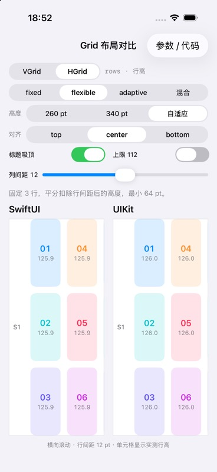
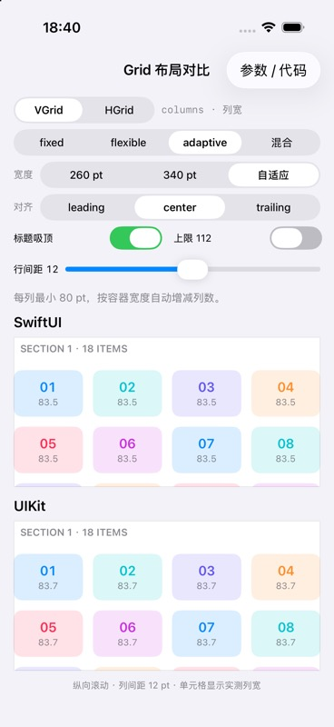
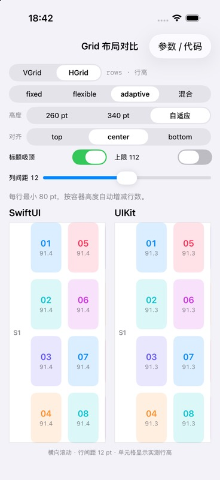
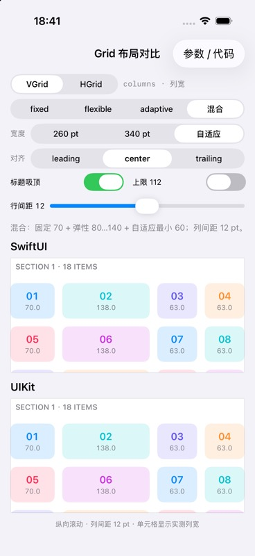
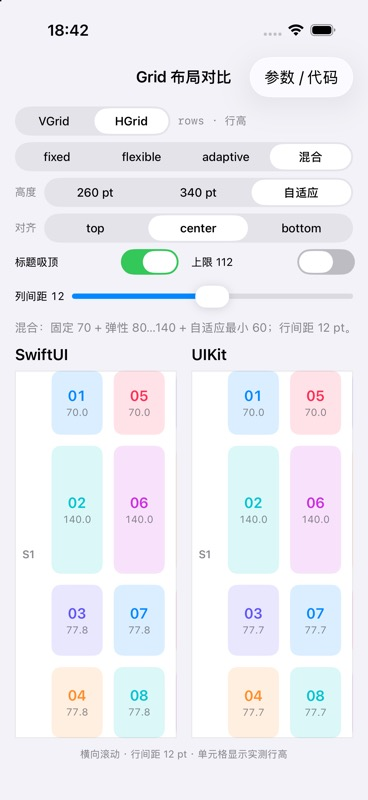

# GridItemSizeLayoutDemo

使用同一组参数，对比 SwiftUI `LazyVGrid` / `LazyHGrid` 和 UIKit compositional layout。

布局库已拆为独立仓库 [UIKitGridLayouts](https://github.com/astralchen/UIKitGridLayouts)。Demo 通过 Git submodule 固定库的提交，仍使用本地 Swift Package 路径 `../Packages/UIKitGridLayouts`，不需要修改 Xcode 工程引用。

## 运行截图

以下为示例 App 在 **iPhone 17 Pro / iOS 26.5 模拟器**上的真实运行截图。四种模式均使用“自适应”容器尺寸、居中对齐、12 pt 主轴间距，并关闭“上限 112”。单元格第二行显示实测列宽或行高。

| 模式 | 纵向 VGrid：上方 SwiftUI，下方 UIKit | 横向 HGrid：左侧 SwiftUI，右侧 UIKit |
| --- | :---: | :---: |
| **fixed**<br>固定 3 条轨道，每条 72 pt |  |  |
| **flexible**<br>固定 3 条轨道，minimum 为 64 pt |  |  |
| **adaptive**<br>minimum 为 80 pt，自动展开轨道 |  |  |
| **混合**<br>混合：fixed 70 + flexible 80…140 + adaptive minimum 60 |  |  |

截图保留两套布局的真实尺寸读数，包括少量小数差异；展示的是当前配置的运行效果，不替代所有边界情况和最低系统版本的验证。

## 运行

1. 首次获取示例后，先在仓库根目录运行 `git submodule update --init --recursive` 下载布局库。克隆示例时也可使用 `git clone --recurse-submodules <示例仓库地址>`。
2. 用 Xcode 打开 `GridItemSizeLayoutDemo/GridItemSizeLayoutDemo.xcodeproj`。
3. 选择 `GridItemSizeLayoutDemo` scheme 和 iPhone / iPad 模拟器，运行。
4. 对比 App 最低 iOS 16；独立库最低 iOS 15，使用 Swift tools 6.3 和 Swift 6 language mode。模拟器无需配置开发团队，真机运行需要自行选择签名团队。

## 对比页

Debug 构建可在 Xcode 的 Run → Arguments 中添加 `--grid-mode flexible --grid-axis vertical`，启动时直接选中截图配置。mode 支持 `fixed`、`flexible`、`adaptive`、`mixed`，axis 支持 `vertical`、`horizontal`。这些参数只设置示例页的初始状态，便于重复采集运行截图。

- **VGrid / HGrid**：纵向网格按列分配宽度；横向网格按行分配高度。
- **fixed**：3 条轨道，每条 72 pt。
- **flexible**：3 条轨道，minimum 为 64 pt。
- **adaptive**：一个定义自动展开，minimum 为 80 pt。
- **混合**：依次为 fixed(70)、flexible(minimum: 80, maximum: 140)、adaptive(minimum: 60)，轨道间距 12 pt。VGrid / HGrid 均可切换；参数页同步展示混合数组代码。
- **260 / 340 / 自适应**：改变交叉轴容器尺寸；若窗口放不下指定尺寸，会缩小到实际可用空间。
- **对齐**：VGrid 使用 leading / center / trailing；HGrid 使用 top / center / bottom。
- **上限 112**：为 flexible / adaptive 设置 maximum，观察剩余空间。
- 混合模式关闭上限时，有效交叉轴尺寸为 340 pt 得到 `[70, 123, 123]`，358 pt 时展开为 `[70, 132, 60, 60]`；开启上限后，340 pt 得到 `[70, 112, 61, 61]`。指定预览尺寸仍受实际可用空间限制。
- **间距**：轨道之间固定为 12 pt；滑块控制滚动方向的行/列间距。
- **标题吸顶**：两边可以独立滚动，观察 Section 标题是否吸附到起始边界。
- **参数 / 代码**：查看初始化参数映射和当前配置对应的 SwiftUI、UIKit 调用。

每个 cell 显示实际测得的列宽或行高。SwiftUI 使用原生 GridItem，不读取 UIKit 包的尺寸计算结果。

## UIKit API

```swift
import UIKit
import UIKitGridLayouts

// 对应 LazyVGrid(columns:alignment:spacing:pinnedViews:content:)
let vertical = UIKitLazyVGridLayout(
    columns: [UIKitGridItem(.adaptive(minimum: 80), spacing: 12)],
    alignment: .center,
    spacing: 12,
    pinnedViews: [.sectionHeaders],
    rowHeight: 56,
    headerHeight: 28
)

// 对应 LazyHGrid(rows:alignment:spacing:pinnedViews:content:)
let horizontal = UIKitLazyHGridLayout(
    rows: Array(
        repeating: UIKitGridItem(.flexible(minimum: 64, maximum: 112), spacing: 12),
        count: 3
    ),
    alignment: .top,
    spacing: 12,
    pinnedViews: [.sectionHeaders],
    columnWidth: 56,
    headerWidth: 28
)

let collectionView = UICollectionView(frame: .zero, collectionViewLayout: vertical)
// 注册 cell / supplementary view，并设置 UICollectionViewDataSource。
```

两种布局均继承 `UICollectionViewCompositionalLayout`。内容仍由 UIKit 数据源提供，布局包不管理 cell 和业务模型。

### 安全区域

安全区域策略由公开布局初始化器的 `contentInsetsReference` 控制，内部 `provider` 不接收视图的 `safeAreaInsets`：

```swift
let layout = UIKitLazyVGridLayout(
    columns: [UIKitGridItem(.adaptive(minimum: 80), spacing: 12)],
    contentInsetsReference: .safeArea
)
```

`provider` 每次从 `environment.container.effectiveContentSize` 读取有效宽度（VGrid）或高度（HGrid），该尺寸已应用容器 inset。再次手动减去 `safeAreaInsets` 会让布局少算可用空间，可能使 adaptive 少排一列或一行。

宿主仍负责 UICollectionView 的约束和 `contentInsetAdjustmentBehavior`。如果需要额外的 section 内容留白，应单独处理 `section.contentInsets`；不要将业务留白与安全区域合并计算。本版只设置主轴 section 间距，没有交叉轴 section padding。

参考：[contentInsetsReference](https://developer.apple.com/documentation/uikit/uicollectionviewcompositionallayoutconfiguration/contentinsetsreference)、[effectiveContentSize](https://developer.apple.com/documentation/uikit/nscollectionlayoutcontainer/effectivecontentsize)。

| SwiftUI | UIKitGridLayouts |
| --- | --- |
| `GridItem.Size.fixed / flexible / adaptive` | `UIKitGridItem.Size` 同名 case 与默认上下限 |
| `LazyVGrid(columns:)` | `UIKitLazyVGridLayout(columns:)` |
| `LazyHGrid(rows:)` | `UIKitLazyHGridLayout(rows:)` |
| `alignment` | group 在交叉轴的 edge spacing |
| `GridItem.spacing` | 轨道之间的间距；不同轨道可分别设置 |
| 网格的 `spacing` | `section.interGroupSpacing` |
| `pinnedViews` | header / footer 的 `pinToVisibleBounds` |
| `content` / `ForEach` / `Section` | 数据源、cell、supplementary view |

## 包的范围和约定

- UIKit 包只依赖 UIKit，独立仓库根目录包含 `Package.swift`，可直接作为 Swift Package 安装。
- `Packages/UIKitGridLayouts` 是独立仓库的 submodule checkout，不在示例中另存一份库源码。安装说明、API 约定和许可证见 [库的 README](https://github.com/astralchen/UIKitGridLayouts#readme)。
- 尺寸来自 `environment.container.effectiveContentSize`，不依赖设备屏幕常量。
- 两种布局都接受 `contentInsetsReference`，默认为 `.safeArea`。容器有效尺寸已应用其 inset，builder 不再减 `safeAreaInsets`。若调用方已经安排好内容区域，可显式传 `.none`；滚动视图的 `contentInsetAdjustmentBehavior` 仍由宿主决定。两种设置分别负责布局参考边界和滚动内容的自动 inset，不要把它们当成同一开关。
- `spacing: nil` 在包内明确为 **8 pt**。SwiftUI 的 nil 是系统默认值，不保证与这里相同。
- UIKit 需要固定主轴尺寸：VGrid 的 `rowHeight` / HGrid 的 `columnWidth`。本版不实现 self-sizing cell。
- header / footer 尺寸默认为 0，不创建对应 supplementary item。传入正尺寸时，数据源必须提供相应标准 element kind 的视图；`pinnedViews` 只控制吸附，不自动创建内容。
- `sectionHeaders` / `sectionFooters` 可以同时使用。演示页只展示 header。
- 支持混合轨道：先扣除 fixed 和间距，再按顺序分配其余轨道，最后展开 adaptive。不同上下限的混排与 SwiftUI 的提议尺寸、多轮测量行为不承诺逐像素一致。
- 极窄容器下 fixed / flexible 保持固定值或 minimum，可能溢出；adaptive 的单条轨道允许缩小到容器尺寸。示例对预览边界进行裁剪。
- 输入必须至少有一条轨道；固定尺寸、minimum、主轴尺寸为有限正数；maximum 不小于 minimum；间距为有限非负数。非法输入通过 precondition 及时暴露。

## 结构与测试

```text
Packages/UIKitGridLayouts/           # 独立库的 Git submodule
  Package.swift
  Sources/UIKitGridLayouts/
    UIKitGridItem.swift
    UIKitLazyVGridLayout.swift
    UIKitLazyHGridLayout.swift
    UIKitGridLayoutBuilder.swift
  Tests/UIKitGridLayoutsTests/
GridItemSizeLayoutDemo/
  GridItemSizeLayoutDemo.xcodeproj
  GridItemSizeLayoutDemo/             # SwiftUI / UIKit 对比页面
  GridItemSizeLayoutDemoTests/        # App 对本地包的集成
  GridItemSizeLayoutDemoUITests/      # 两套真实 UI 的尺寸、对齐、吸附对比
```

先执行 `git submodule update --init --recursive`。单独在 Xcode 打开 `Packages/UIKitGridLayouts/Package.swift`，选择 `UIKitGridLayouts` scheme 和 iOS Simulator，可运行包测试。App 工程中的依赖包 scheme 可能不包含包测试；如果 Xcode 提示包已经打开，请先关闭 App 工程再打开 Package。选择 App scheme 可运行集成与 UI 测试。包依赖 UIKit，不能在 macOS 目标上直接执行普通 `swift test`。

混排边界测试覆盖展开阈值前后、fixed 声明位置、非固定轨道顺序、flexible / adaptive 上限、空间不足和多 adaptive 的不同间距。这些断言固定的是本包的一轮分配约定；UI 测试另外比较原生 SwiftUI 和 UIKit 前 6 个 cell 的尺寸、相对位置及换行，两者不共享尺寸计算结果。

2026-10-28 独立库验证：Xcode MCP 在 iPhone 17 Pro / iOS 26.5 模拟器运行当前 tools 6.3 / iOS 15 配置的 14 个包测试，全部通过。另用 Swift 6.3.3 完成 manifest 解析及 iOS 15 目标编译检查；未完成 iOS 15 运行时验收。

此前新增 App 输入一致性测试及混合 UI 对比测试已编译，但运行停在模拟器测试宿主启动阶段，取消后未得到断言结果；不能将包测试结果视作完整的 SwiftUI / UIKit UI 一致性验证。

参考：[LazyVGrid](https://developer.apple.com/documentation/swiftui/lazyvgrid)、[LazyHGrid](https://developer.apple.com/documentation/swiftui/lazyhgrid)、[UICollectionViewCompositionalLayout](https://developer.apple.com/documentation/uikit/uicollectionviewcompositionallayout)。
